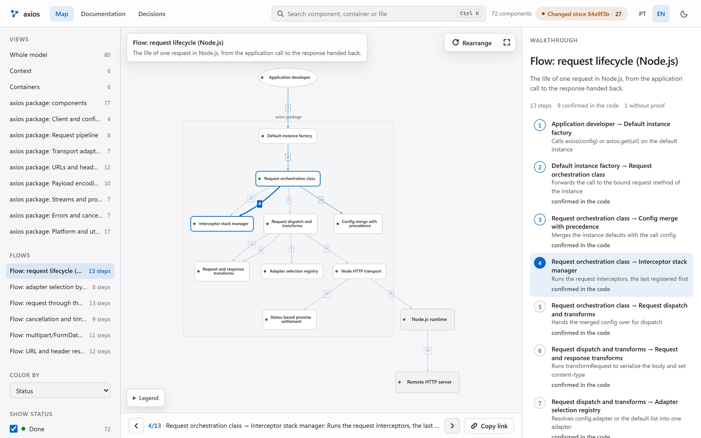
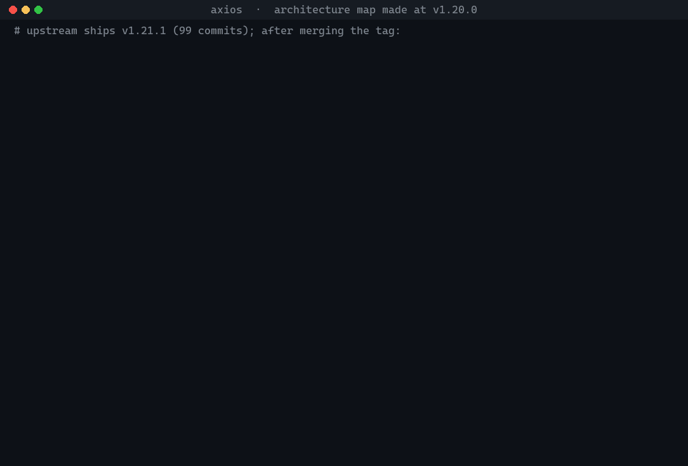

# Lodemap

**A C4 architecture map that lives in your repository and fails the build when the code outgrows it. A skill for
[Claude Code](https://code.claude.com).**

Lodemap builds a C4 model of a codebase in [Structurizr DSL](https://docs.structurizr.com/dsl), keeps it versioned
next to the code, and generates everything else from it: an interactive explorer, a reader for docs and decisions
(ADRs), per-component metrics, and a coverage test that fails when a module is missing from the model.

[](https://skarl007.github.io/lodemap/demo/)

**Live demo:** the [explorer](https://skarl007.github.io/lodemap/demo/explorador/) and the
[docs reader](https://skarl007.github.io/lodemap/demo/leitor/) of a map of [axios](https://github.com/axios/axios)
(72 modules, 6 animated flows), made at v1.20.0 and updated to v1.21.1. Static pages, no server, no external request.

### The gate, on a real release

The map was made at axios v1.20.0. Upstream then shipped v1.21.1 (99 commits, 27 files changed under `lib/`, three of
them new). After merging the tag, the coverage test failed and named the three files. The recording below shows the
real output of each command (long paths cut).



| Step | What ran | Result |
|---|---|---|
| `pytest tests/test_arquitetura_cobertura.py` | script | fails: 3 modules outside the model |
| `esqueleto.py rascunho` | script, 0 tokens | 3 new modules, 16 of the 24 changed files with a different public surface, 12 new relationships |
| `descrever.py` | one Haiku call, 26,029 tokens, 34 s (the rerun in the recording: 26,660 tokens, 37 s) | describes the 3 new modules and reviews the 16; 15 sentences kept word for word, 1 changed (the cookie helper gained a Cookie Store API path); the rerun kept 14 |
| `lodemap-modelador` | Sonnet, 19 calls, 129 s, US$ 0.45 API-equivalent | container and status of the 3 new components, verbs of the 12 relationships |
| `atualizar.py --incremental` | scripts, 17 s | DSL export, explorer, reader, derived docs |
| `pytest tests/test_arquitetura_cobertura.py` | script | passes |

The orchestrating session is not counted. The update was later repeated twice from the same commit: the script
step gave the same lot, the model step cost US$ 0.35 and US$ 0.28 (13 and 9 calls), and the map came out with the
same 72 components and 188 relationships. One of the three new modules landed in a different area in the first run,
and the wording of verbs and sentences varies between runs.

### When the map updates

Updating on every commit wastes money and attention: each model session pays for its context again, and regenerating
versioned files after every commit dirties the tree without changing the map. One script decides, for zero tokens:

```bash
python docs/architecture/structurizr/scripts/lodemap_decidir.py --resumo
```

| It answers | When | Model |
|---|---|---|
| `nada` (nothing) | nothing relevant changed, or too little since the last run | no |
| `scripts` | the model sources or the set of modules changed, or 10 commits went by | no |
| `adiar` (defer) | a new module may wait: it goes into `pendentes.json`, with its date, in your commit | no |
| `descrever` (describe) | 10 or more modules changed their public surface | one Haiku call |
| `modelar` (model) | modules waited past the limit or the deadline, a path the model cites is gone, or 10 or more new import relations | one Sonnet session for everything pending |

The gate is strict by default: any new module fails the coverage test. To let structure wait, give it a tolerance in
`lodemap.json`:

```json
"politica": {"tolerancia_modulos": 3, "tolerancia_dias": 14}
```

Then up to 3 modules may wait up to 14 days, each listed by name and date in a versioned file a reviewer can read.
The fourth module, or day 15, fails the test again, and running the command twice does not extend a deadline. When
the model finally runs, it handles the whole lot in one session. The opt-in git hook follows the same answer and
never calls a model.

Replayed on the axios merge above, for zero tokens: with the default policy the script answers `modelar` and names the
3 files; with a tolerance of 3 it answers `adiar`, the test passes once the 3 are listed, and with the skill in reach
it still answers `modelar`, because the merge also brought 12 new import relations (limit 10). The lot it reports, 3
modules, 16 reviews and 12 relations, is exactly what the real update handled. How much batching saves has not been
measured yet.

## What is different

- **A gate, not a picture.** `tests/test_arquitetura_cobertura.py` is installed in your project and fails when a
  module matched by your globs has no component, when a component points to a path that no longer exists, or when an
  exception has no reason. Put it in CI and the map cannot silently fall behind.
- **Updates cost no model call.** `atualizar.py --incremental` regenerates every output with scripts. A model is
  asked again only for modules whose *public surface* changed (docstring, imports, signatures, public symbols). On
  five release pairs of [rich](https://github.com/Textualize/rich), 78 changed files needed 29 reviews (63% fewer).
- **Measured cost, published with its caveats.** Every number below names the repository, the model and what was left
  out. Nothing here is a projection unless it says so.

What Lodemap does **not** claim: that the map makes a coding agent faster or more accurate. That has not been
measured (see [Limits](#limits)).

## Install

Requires Python 3.11+ and git. On Debian/Ubuntu the interpreter is `python3`.

```bash
git clone https://github.com/skarL007/lodemap && cd lodemap
python -m lodemap instalar --perfil padrao            # dry run: prints every change, writes nothing
python -m lodemap instalar --perfil padrao --aplicar  # applies, with backups and a manifest
python -m lodemap doctor                              # checks Python, git, Java, Structurizr CLI, Graphviz, claude
```

Undo with `python -m lodemap reverter`: it restores the exact bytes of every file the install touched, newest install
first. It is all-or-nothing: if a touched file changed after the install, it refuses and names the file.

| Profile | What it installs |
|---|---|
| `minimo` | The skill (a link from `~/.claude/skills/lodemap` to this folder) and six `lodemap-*` agents in `~/.claude/agents/`. |
| `padrao` | The above, plus a one-time hint (`SessionStart` hook) in repositories that have no map. |

The installer never overwrites a file, key or link owned by someone else unless you pass `--forcar`, and never touches
the hooks of other tools. `python -m lodemap status` shows what is installed.

Generating a map also needs Java 21, the [Structurizr CLI](https://docs.structurizr.com/cli) and Graphviz. `doctor`
tells you which of them is missing and where it looked.

## Use

In Claude Code, inside your repository, ask for the map ("lodemap", "architecture map", "C4 model of this project").
The skill always starts with a plan that spends no tokens, and waits for your OK:

```bash
python -m lodemap plano --repo .       # modules found, estimated cost and time, files that would be written
python -m lodemap consentir --repo . --escopos gerar,modelo --orcamento-mensal 5
python -m lodemap revogar --repo .
```

After the first generation:

```bash
python scripts/atualizar.py --incremental   # regenerate only if something relevant changed; no model call
python scripts/ver_arquitetura.py           # serve on 127.0.0.1 and open the explorer
python scripts/instalar_gancho.py           # optional: update on every commit and merge
```

## How it works

1. **Inventory and skeleton, by script.** `inventario.py` and `codegraph_ponte.py` list modules and the import edges
   between them. `esqueleto.py rascunho` writes a JSON with one suggested component per module and one suggested
   relationship per pair with edges, decisions left blank.
2. **Descriptions, by one lean call.** `descrever.py` fills name, one-sentence description and area with a single
   `claude -p` call (Haiku, no tools, JSON Schema output, the area restricted to the areas already decided). A
   deterministic gate rejects generic or ungrounded sentences and retries only those, once.
3. **Decisions, by the modeler.** The `lodemap-modelador` agent decides containers, areas, status and which suggested
   relationships are real, in separate phases with a fresh agent each, so context stays small.
4. **Everything else, by script.** `esqueleto.py renderizar` writes the DSL and the static views; `atualizar.py`
   exports the workspace and builds the explorer, the reader and the derived documents.
5. **Two gates.** The coverage test (structure) and `qualidade.py`, a 14-criterion rubric with no model in the loop
   (description quality, relationships backed by code edges, orphan components, and so on).

Six agents, one job each: `lodemap-inventario`, `lodemap-modelador` (the only one that decides architecture),
`lodemap-metricas`, `lodemap-gerador`, `lodemap-verificador` and `lodemap-revisor-visual`. Routing, order and saving
rules are in [SKILL.md](SKILL.md).

## Measured

### Cost of a full map

Tokens read from the subagent transcripts (usage deduplicated by message id), priced at the public API rates even
though the runs used a Claude Code subscription. All four token types count: input, cache writes, cache reads, output.

| Run | Model | Calls | Time | API-equivalent cost |
|---|---|---:|---:|---:|
| Full map, 63-module repository, one agent | Sonnet | 93 | 25 min | US$ 3.61 |
| Same repository and commit, script skeleton + fresh agent per phase | Sonnet (+ Haiku verifier) | 98 | 14 min | US$ 2.84 |
| Update on a commit with no structural change | scripts only | 0 | 11–17 s | US$ 0 |
| Full map of axios v1.20.0 (69 modules), skeleton + phases + lean descriptions | Sonnet (+ one Haiku call) | 51 | 10 min | at most US$ 1.74 |
| Update of that map to axios v1.21.1 (3 new modules, 16 reviews, 12 new relationships), three runs | Sonnet (+ one Haiku call) | 20, 14, 10 | 1 to 3 min | at most US$ 0.47, 0.36, 0.29 |
| Full map of go-chi/chi v5.4.0 (Go, 35 modules), with every description checked against the code | Sonnet (+ one Haiku call) | 67 | 9 min | at most US$ 1.92 |
| Update of that map to chi v5.5.0 (1 new module, 1 review) | Sonnet (+ one Haiku call) | 8 | 1 min | at most US$ 0.22 |

The axios and chi rows are on public repositories and can be redone: the Sonnet calls are counted as above and the
Haiku call is priced as if every token were output, which bounds it at US$ 0.03 or less. Time is model time; the
scripts add under a minute. The smallest update still pays for the context of one Sonnet session: about 37,000
tokens of cache writes to decide one module on chi.

Not included: the orchestrator session that dispatched the agents. The two full-map rows are the same repository but
not a controlled test (the first run also fixed six defects of the skill). `plano` scales the Sonnet run linearly by
module count, which is an assumption. Method and raw figures:
[references/benchmark-e-custo.md](references/benchmark-e-custo.md).

### Lean description route

Same quality band as a subagent, with fewer tokens, on two public repositories:

| Repository | Modules | Lean route (Haiku medium) | Subagent |
|---|---:|---|---|
| [rich](https://github.com/Textualize/rich) (Python) | 76 | score 96.9 (95% interval 92.7–98.7), 64,670 tokens | score 96.9, 129,385 tokens |
| [axios](https://github.com/axios/axios) (JavaScript) | 72 | area agrees with the reference in 0.90, 70,178 tokens, 105 s | 98,869 tokens, 240 s |

The reference is a Sonnet run, not a human gold set. A repeat on rich scored 95.3. Details and the variants that
lost: [references/rota-enxuta.md](references/rota-enxuta.md).

### Import edges without an index

Without a CodeGraph index, relationships are suggested from imports read by a built-in parser (Python, JS/TS, Go,
Rust, Java, Kotlin, C#, C/C++). In Go, where files of a package see each other without an import, the edge comes
from the symbol used: on go-chi/chi it found 31 edges, all 31 confirmed in the code, and missed 3 real ones (method
and interface use). Precision by language: [references/precisao-ast.md](references/precisao-ast.md).
Suggested edges are never written to the model automatically; the modeler confirms each one in the code.

## Language

Generated pages, docs, DSL labels and views come in Portuguese by default and in English with `"idioma": "en"` in
`lodemap.json` (or `novo_mapa.py --idioma en`); the explorer and the reader have a PT | EN switch. The prompts of the
skill, its command names (`instalar`, `plano`, `consentir`) and most terminal messages are in Brazilian Portuguese;
the coverage test and the update pipeline (`rascunho`, `renderizar`, `descrever.py --resumo`, `atualizar.py`) print in
the map language.

## Limits

- **Not measured: whether the map helps an agent.** A study of repository context files
  ([arXiv 2602.11988](https://arxiv.org/abs/2602.11988)) found they do not generally raise task success and add over
  20% to inference cost; it did not test C4 maps. Lodemap offers documentation that stays current and a gate that
  fails when the model drifts.
- **Run end to end on Windows and on Linux; macOS is not.** On Linux (WSL Ubuntu 24.04, Python 3.12, Java 21, the
  real Structurizr CLI) the test suite passes (414 tests, 1 skipped), the full regeneration took 9 s on the axios
  map and 5 s on the chi map, the generated docs and inventories of axios came out byte for byte as on Windows
  (only timestamps differ), the quality gate gave the same scores, and the real git hook regenerated on an
  architecture commit and stayed quiet on a code-only commit. The model phases (agents) ran on Windows only.
  macOS has branches covered by tests that simulate the platform and nothing more.
- **Cost was measured on few repositories**, of 22 to 98 modules. Two are public (axios and chi). Only the axios
  update was repeated (three runs); every other figure is one run. Monorepos and very large repositories are not
  measured.
- **Descriptions written by the lean route can be wrong.** On chi (Go) the modeler checked all 35 sentences against
  the code: 6 stated something false and 2 were vague, and it fixed them. That check costs model calls (the chi
  map cost more than the axios map with half the modules). On axios the sentences were never checked this way. The
  quality score measures form, not truth.
- **The fingerprint misses behavior that changes with no change of surface**: 3 of 178 changed files in the two
  audited repositories. See [references/digital-semantica.md](references/digital-semantica.md).
- The quality gate compares against `references/baseline-qualidade.json`, the first map the skill produced. On your
  project read the absolute score and the per-criterion notes, or record your own baseline with `--gravar-baseline`.
- Consent is a record the skill and its agents read and follow. No hook enforces it, and the monthly ceiling is
  checked per run, not summed across runs.
- With the default globs an empty `__init__.py` counts as a module and needs a component or an entry in `EXCECOES`.
- Files that live next to the code and are not modules (tests, examples, fixtures) are left out by the
  `"ignorar"` list in `lodemap.json`. A new map gets the defaults of its language (Go: `**/*_test.go`,
  `**/_*/**`, `**/testdata/**`; JS/TS: `**/*.test.*`, `**/*.spec.*`; Python: `**/test_*.py`, `**/*_test.py`,
  `**/conftest.py`); a map made before the list existed has none until you add it.
- `--incremental` compares commits: an uncommitted new module shows up after the commit (or run
  `lodemap_diff.py --trabalho`).
- The reader draws Mermaid offline with an embedded build; `mindmap`, `architecture` and math load a larger build
  only on pages that need it.

## Privacy and security

- Scripts run locally and make no network call. The model-driven steps send the files they read to Anthropic through
  your own Claude Code. The only network code is the optional `scripts/synapse_ponte.py`, a bridge to
  a separate engine that is not public; with no engine configured it writes down the reason and exits.
- Generated pages load nothing from a CDN; the embedded libraries are listed in
  [THIRD-PARTY-NOTICES.md](THIRD-PARTY-NOTICES.md).
- The optional git hook runs the scripts of the repository only while their hash matches the one approved at install
  time. After a pull that changes them it logs a warning and runs nothing until you approve again.
- The installer backs up every file before writing. Backups stay in `~/.claude/.lodemap-instalador/`.
- Reporting a vulnerability: [SECURITY.md](SECURITY.md).

## Repository layout

```
SKILL.md       what Claude Code reads on every run (the operational core)
references/    read on demand: modeling guide, gate criteria, pitfalls, measurements
agents/        the six lodemap-* agents
lodemap/       CLI: python -m lodemap (instalar, reverter, status, doctor, plano, consentir, revogar, verificar)
scripts/       inventory, skeleton, lean descriptions, quality gate, bridges
templates/     what a new map copies into your repository (DSL, explorer, reader, scripts, tests)
hooks/         the one-time hint hook
tests/         run with: python -m pytest
```

## License

[MIT](LICENSE). Contributions: [CONTRIBUTING.md](CONTRIBUTING.md). Changes: [CHANGELOG.md](CHANGELOG.md).
